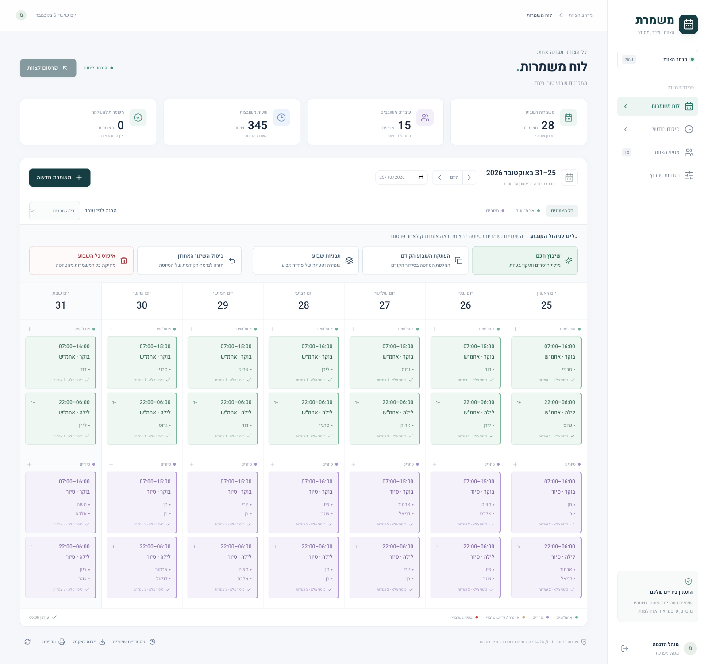
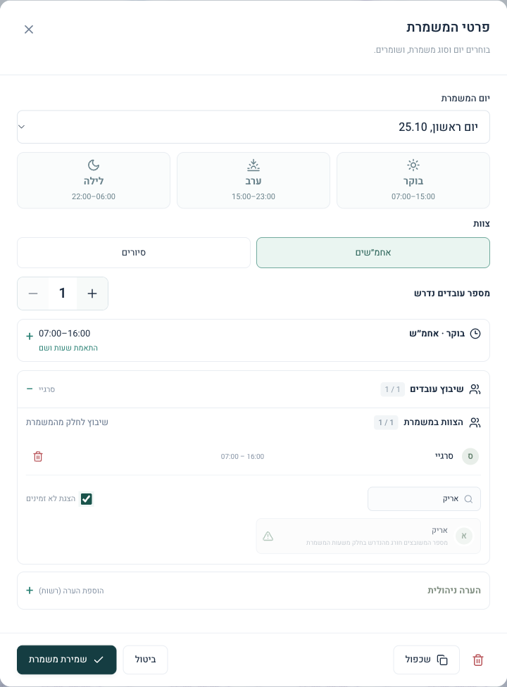
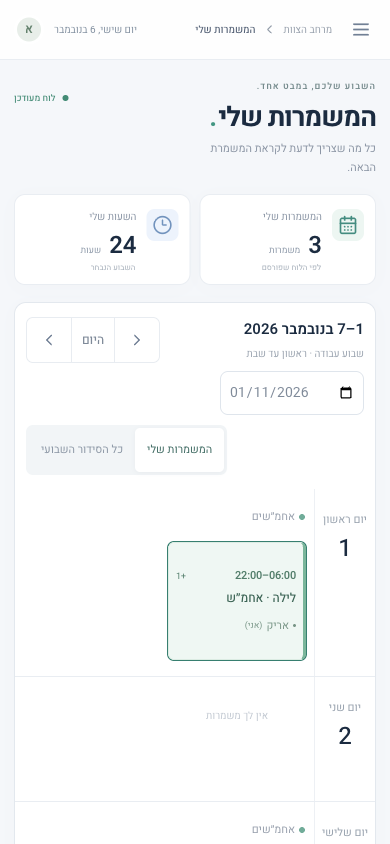
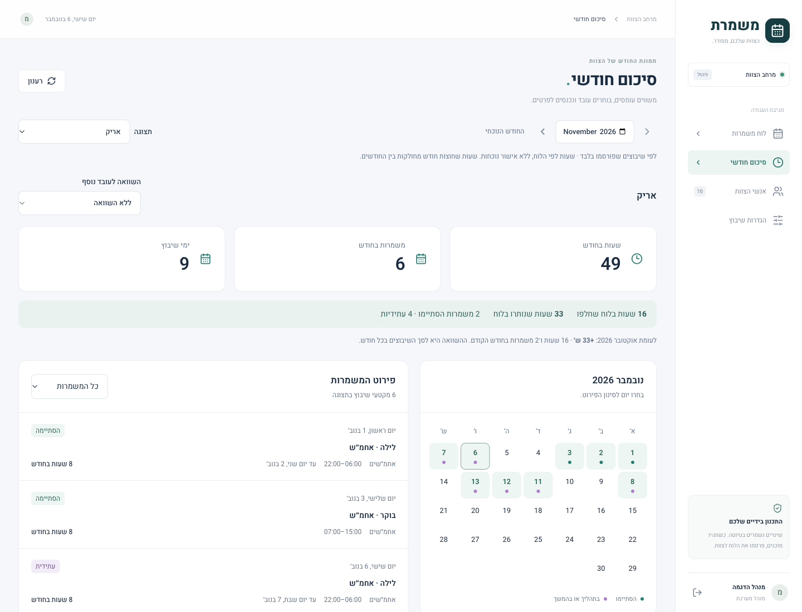
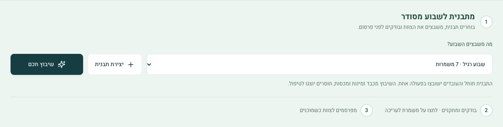
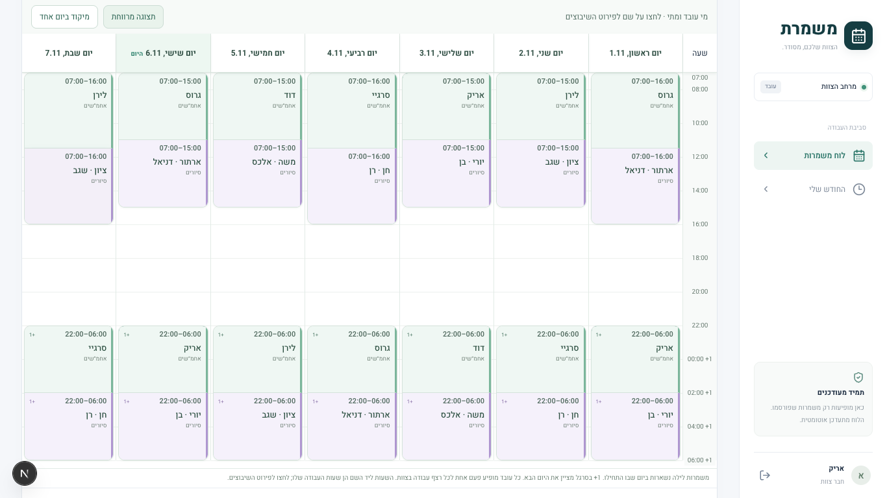
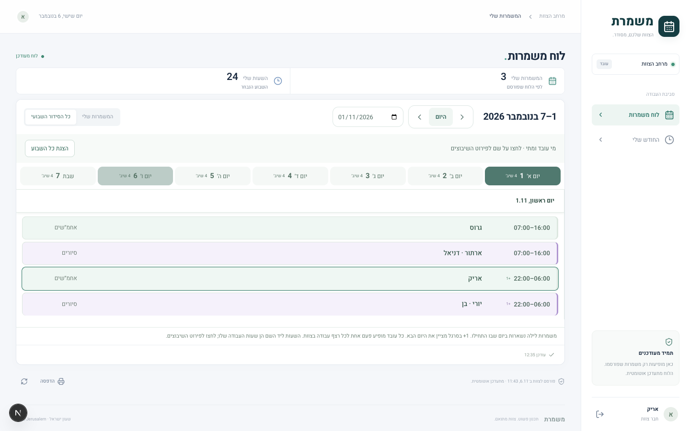
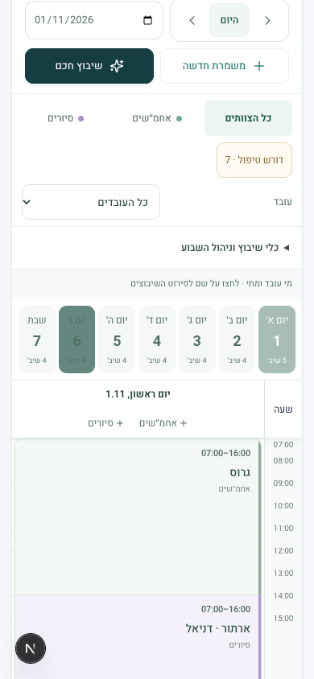

# משמרת | Mishmeret

> ענף העבודה כולל כעת תהליך הצעת שיבוץ לפני החלה, תחום ימים/צוותים מפורש, נעילות, כיסוי לפי מקטעים, בדיקה מחייבת לפני פרסום ומסך עובד אישי. [התנהגות והפעלה מעודכנות](docs/WORKFLOWS.md). תיאורי התצוגה והצילומים ההיסטוריים בהמשך יתעדכנו בסיום סבב העבודה; המסמך המקושר מתאר את השינוי המקומי ואינו טענה לפריסה באתר החי.

**סידור עבודה שבועי לאחמ״שים ולסיורים — מהתכנון של המנהל ועד המשמרת הבאה של העובד.**

מערכת Full Stack בעברית וב־RTL: המנהל בונה טיוטה פרטית, בודק כיסוי והתנגשויות ומפרסם את הסידור לצוות. העובדים רואים את הגרסה שפורסמה, עם תצוגת משמרות אישית המותאמת לטלפון. הנתונים נשמרים ב־PostgreSQL דרך Prisma, ללא SQLite וללא fallback לנתוני דמו בזיכרון.

[פתיחת הדמו החי](https://mishmeret-shifts.vercel.app) · [מדריך שימוש](#מדריך-שימוש) · [סיכום חודשי](#סיכום-חודשי) · [הפעלה מקומית](#הפעלה-מהירה) · [מנוע השיבוץ](#מנוע-השיבוץ) · [דוח האימות](VERIFICATION.md) · [גבולות המימוש](#גבולות-המימוש)

סביבת ההדגמה פועלת ב־Vercel וב־Neon PostgreSQL בתוכנית Free. החשבונות שלמטה מיועדים להדגמה פיקטיבית; לשימוש בצוות אמיתי יש להכין מסד וחשבונות פרטיים לפי הוראות ההתקנה ללא דמו.

## סיור קצר במערכת

### 1. מנהל — כל השבוע במסך אחד

שבעה ימים, הפרדה צבעונית בין אחמ״שים לסיורים, שעות ושמות משובצים בכל כרטיס. בראש הלוח מוצגים סיכום השבוע וסטטוס הפרסום. אזור ״כלים לניהול השבוע״ מרכז שיבוץ חכם, העתקה, תבניות, ביטול ואיפוס, בנפרד ממסנני התצוגה. הצילום מציג שבוע שכבר פורסם; עריכה נוספת תישמר בטיוטה עד לפרסום הבא.



### 2. שיבוץ — פרטי המשמרת והסבר לפני החלטה

לחיצה על משמרת פותחת חלונית לבחירת יום, שעות, צוות וכמות עובדים. אפשר לבדוק מועמדים ולראות מדוע אינם זמינים. בדוגמה, המשמרת כבר מאוישת והמערכת מסבירה שהוספת העובד תחרוג מכמות העובדים הנדרשת. הצילום מציג חיפוש בלבד, ללא שמירת שינוי.



### 3. עובד — המשמרות שלי בנייד

העובד רואה סיכום אישי של משמרות ושעות, יכול לעבור בין שבועות ובין התצוגה האישית ללוח הצוות. משמרת לילה מסומנת ב־‎+1 לציון סיום ביום הבא. תצוגה זו מבוססת על הפרסום האחרון, ולכן היא יכולה להיות שונה מטיוטת המנהל.



### 4. סיכום חודשי — מהתמונה הכוללת לפירוט היומי

המנהל יכול להשוות עובדים או לבחור עובד ולראות שעות, משמרות, ימי שיבוץ ופירוט לפי יום. בדוגמה נבחר עובד הדמו אריק; מוצגת הבחנה בין משמרות שהסתיימו למשמרות עתידיות. גם העובד יכול לפתוח את ״החודש שלי״ מתוך התפריט. הנתונים מחושבים מהסידור שפורסם, ולא מהטיוטה או מדיווחי נוכחות.



הצילומים צולמו מחדש באתר החי ב־6 בנובמבר 2026, עם הממשק המעודכן ונתוני הדגמה קיימים, ללא שינוי או פרסום של סידור עבודה. לוח המנהל מציג את 25–31 באוקטובר; העובד והדוח מציגים נתונים מנובמבר. [מקור הצילומים, גדלים והיקף הבדיקה](docs/screenshots.md).

## טכנולוגיות והחלטות מימוש

| שכבה | מימוש |
| --- | --- |
| ממשק ושרת | Next.js 16 App Router, React 19, TypeScript, Route Handlers |
| עיצוב ונגישות ממשק | Tailwind CSS 4, Radix UI, Lucide, עברית ו־RTL |
| נתונים | PostgreSQL, Prisma 6; טיוטה ו־snapshots נפרדים לפרסומים |
| תקינות והרשאות | Zod, sessions בשרת, bcrypt, בדיקת תפקיד ו־Origin |
| זמן וייצוא | Temporal polyfill ו־Asia/Jerusalem; ייצוא Excel באמצעות ExcelJS |
| בדיקות | Vitest ליחידות, Playwright לתהליכי דפדפן |
| סביבת ריצה | Node.js 22; הדמו ב־Vercel וב־Neon PostgreSQL |

הסטאק מאומת מול [package.json](package.json) והקוד; הגרסאות המדויקות נעולות ב־[package-lock.json](package-lock.json). תוצאות בדיקות קודמות מופיעות בדוח האימות, ואינן טענה להרצה חדשה במסגרת עדכון התיעוד.

- **תכנון ופרסום נפרדים:** [שכבת הלוח](src/lib/weeks.ts) שומרת snapshot לפרסום בטרנזקציה ובודקת גרסה כדי למנוע דריסת עריכה מקבילה. תשובות לעובדים מסננות מידע ניהולי.
- **שיבוץ מוסבר:** [מנוע השיבוץ](src/lib/scheduler.ts) בודק זמינות, תפקידים, חפיפות, מנוחה ומכסות. זהו מנוע greedy דטרמיניסטי, ללא שירות AI חיצוני וללא הבטחה לאופטימום גלובלי.
- **זרימת עבודה מלאה:** עריכת משמרות, חלוקת שעות, היסטוריה וביטול שינוי, תבניות שבוע, ניהול צוות, דוחות חודשיים המבוססים על שיבוצים שפורסמו וייצוא Excel. פירוט והגבלות בהמשך.

**English summary:** Mishmeret is a Hebrew, RTL shift-scheduling application built with Next.js, React, TypeScript and PostgreSQL. Managers plan private drafts, review constraint-based assignments and publish a schedule; employees view their published shifts on mobile. The live demo uses fictional accounts and data.

## מדריך שימוש

### כניסה ראשונה לדמו

1. פתחו את [הדמו החי](https://mishmeret-shifts.vercel.app), הרחיבו ״כניסה לחשבונות הדגמה״ ובחרו ״מנהל הדגמה״ או ״עובד הדגמה״. הכפתור ממלא את הפרטים; לאחריו לחצו ״כניסה למערכת״. פרטי החשבונות מופיעים גם בהוראות ההפעלה המקומית בהמשך.
2. בחרו שבוע באמצעות החצים או שדה התאריך. ״היום״ מחזיר לשבוע הנוכחי. הדמו משותף: אם השבוע ריק, אפשר לעבור לשבוע אחר; אין צורך לאפס או לשנות נתונים כדי להתרשם.
3. בנייד פתחו את התפריט העליון כדי לעבור בין הלוח לדוח החודשי. החלפת תפקיד נעשית באמצעות ״יציאה מהמערכת״ וכניסה לחשבון השני.

### מנהל — מתכנון ועד פרסום

1. התחילו ב״אנשי הצוות״ ובהגדרות השיבוץ: הגדירו תפקידים מותרים, זמינות, חופשות ומכסות. אלה הכללים שלפיהם נבדקים המועמדים; שם או כמות עובדים בלבד אינם מספיקים לשיבוץ תקין.
2. בחרו שבוע. לחצו ״משמרת חדשה״, על כפתור הוספה ביום הרצוי או על כרטיס קיים. הגדירו יום, צוות, שעות וכמות עובדים; הרחיבו ״שיבוץ עובדים״ לבחירת העובדים. ״הצגת לא זמינים״ חושפת הסבר לחסימה, ו״שיבוץ לחלק מהמשמרת״ מאפשר חלוקת שעות.
3. ״שמירת משמרת״ מעדכנת את הטיוטה בלבד. באזור ״כלים לניהול השבוע״ אפשר להפעיל ״שיבוץ חכם״ ולבחון את התוצאה והחוסרים. הפעולה אינה מפרסמת לצוות ואינה מבטיחה מילוי מלא.
4. בדקו את ההתראות והכיסוי. שגיאות שיבוץ חוסמות פרסום; חוסר בכוח אדם מחייב אישור מפורש. לאחר בדיקה לחצו ״פרסום לצוות״. עד אז העובדים ממשיכים לראות את הפרסום הקודם.

מסנני צוות ועובד משנים את התצוגה בלבד. לעומתם, העתקה, תבנית ואיפוס פועלים על הטיוטה של השבוע כולו — גם אם מופעל סינון. ״איפוס כל השבוע״ מוחק את משמרות הטיוטה לאחר אישור; הסידור שכבר פורסם נשאר עד לפרסום הבא. אפשר לחזור באמצעות ״ביטול השינוי האחרון״.

### עובד — הלוח האישי והחודש שלי

״המשמרות שלי״ מציג את השיבוצים האישיים; ״כל הסידור השבועי״ מציג את הצוות. אפשר לעבור בין שבועות, והסימון ‎+1 בכרטיס לילה מציין סיום ביום הבא. הלוח מתרענן בחזרה לחלון ובכל 20 שניות כשהוא גלוי. אם מופיע ״ממתין לפרסום״, נדרש פרסום מצד המנהל; אם אין משמרות אישיות, בדקו את השבוע שנבחר ואת לוח הצוות.

לסיכום תקופה פתחו ״החודש שלי״. בחרו חודש, לחצו על יום כדי לסנן את הפירוט ובחרו אם לראות את כל המשמרות או רק משמרות שהסתיימו/נותרו. ״רענון״ בדוח טוען את הנתונים מחדש; רענון הלוח האוטומטי אינו רענון אוטומטי של הדוח. [הסבר החישובים וההשוואות](#סיכום-חודשי).

### תבניות, היסטוריה וניהול צוות

| מטרה | היכן ומה עושים |
| --- | --- |
| להתחיל מסידור קודם | ״העתקת השבוע הקודם״ באזור כלי הניהול. בדקו את הודעת האישור ואת השיבוצים לאחר ההחלפה. |
| לשמור סידור חוזר | ״תבניות שבוע״: תנו שם ושמרו את השבוע כתבנית; החלה על שבוע אחר מחליפה את הטיוטה לאחר אישור. |
| לבדוק או לבטל שינוי | ״היסטוריית שינויים״ מתחת ללוח מציגה את האירועים; ״ביטול השינוי האחרון״ נמצא באזור כלי הניהול. |
| לעדכן עובד | ״אנשי הצוות״: תפקידים, מכסה, זמינות, חופשות והעדפות. השבתת עובד שומרת היסטוריה ומבטלת את גישתו. |
| לשנות כללי שיבוץ | ״הגדרות שיבוץ״. מכסת ברירת המחדל לעובדים חדשים אינה דורסת מכסות אישיות קיימות. |

### ייצוא, הדפסה ופתיחה מהטלפון

מתחת ללוח מופיעים ״ייצוא לאקסל״ למנהל ו״הדפסה״. קישור ה־Excel בממשק מייצא את טיוטת השבוע הנבחר; בהדפסה מנהל מקבל טיוטה, ועובד מקבל את הגרסה שפורסמה לפי התצוגה האישית או הצוותית שנבחרה. אין להסיק שהטיוטה שבקובץ כבר פורסמה לצוות.

אפשר להשתמש באפשרות ההתקנה/ההוספה למסך הבית שהדפדפן מציע, כאשר היא זמינה. המערכת דורשת רשת: אין גישה ללוח פרטי offline, ובניתוק מוצג הסבר עם אפשרות לניסיון נוסף. לא בוצעה בדיקת התקנה במכשיר iPhone פיזי.

## הפעלה מהירה

נדרשים Node.js 22 ו־PostgreSQL 17 ומעלה (או מסד PostgreSQL מנוהל). גרסאות התלויות המדויקות נעולות ב־package-lock.json.

```bash
npm ci
cp .env.example .env
```

הגדירו `.env` עם `DATABASE_URL` למסד שלכם ו־`APP_URL` לכתובת המדויקת של האתר. לפיתוח: `http://localhost:3000`. בקשות שינוי ממקור אחר ייחסמו.

אפשר להפעיל PostgreSQL באמצעות Docker:

```bash
# הגדירו POSTGRES_PASSWORD ב־.env, בנוסף ל־DATABASE_URL.
docker compose up -d db
npm run db:generate
npm run db:migrate
```

ליצירת נתוני דמו במסד **ריק**, הגדירו ב־`.env`:

```dotenv
SEED_DEMO=true
DEMO_ADMIN_PASSWORD=DemoAdmin!2026
DEMO_EMPLOYEE_PASSWORD=DemoWorker!2026
```

```bash
npm run db:seed
npm run dev
```

פתחו [את המערכת המקומית](http://localhost:3000). שני חשבונות ההדגמה:

| תפקיד | אימייל | סיסמת הדמו בדוגמה |
| --- | --- | --- |
| מנהל | `admin@demo.local` | `DemoAdmin!2026` |
| עובד — אריק | `employee@demo.local` | `DemoWorker!2026` |

ה־seed יוצר 15 עובדי דמו ושלושה שבועות סביב התאריך הנוכחי בישראל. הגרסאות שפורסמו תקינות. בטיוטת השבוע הנוכחי יש משמרת תגבור עם חפיפה מכוונת ומשמרת חסרה לצורך הדגמה. לפני פרסום, מחקו/תקנו את התגבור. `SEED_DEMO=false` מונע זריעה; הרצה חוזרת אינה דורסת מסד שכבר מכיל נתונים. כפתורי מילוי פרטי הדמו בדף הכניסה משתמשים בסיסמאות שבטבלה; אם בחרתם סיסמאות אחרות יש להקליד אותן.

## עבודה יומיומית

ראש הלוח מציג פס סיכום שבועי, שורת בחירת שבוע עם כפתורי „משמרת חדשה” ו„שיבוץ חכם” זה לצד זה, ומתחתיה מסננים. לחיצה על „שיבוץ חכם” פותחת חלון עם טווח השבוע, בחירת תבנית, יום יעד לתבנית יומית, יצירת תבנית והסבר על השיבוץ. הפעולה מתחילה רק בלחיצה על „הפעלת שיבוץ חכם”; בשבוע עם משמרות נשמר גם שלב האישור הקיים. יצירת תבנית מתוך החלון מחזירה אליו עם התבנית החדשה שנבחרה. העתקה וביטול שינויים נשארים באזור „כלי שיבוץ וניהול השבוע”, הסגור כברירת מחדל. כותרת הלוח מרכזת את טווח השבוע, מעבר בין שבועות ובחירת תאריך. מתחתיה מסנני צוותים עם סימון הבחירה וסינון לפי עובד. בטלפון הפקדים מסתדרים בשורות ושני כפתורי הפעולה חולקים שורה אחת.

- הטלפון הוא תצוגת העבודה הראשית: בחירת יום מהירה עם מספר המשמרות לכל יום, ציר שעות ופקדי מגע גדולים, סיכום מצומצם וטפסי עריכה עם גלילה פנימית וכפתורי פעולה קבועים. במחשב נשמרת תצוגת שבעה ימים במקביל.
- הלוח מציג סרגל שעות משותף וכרטיסים ברוחב מלא, עם שמות ושעות עבודה ללא שורות המשך כפולות. השעות המדויקות כתובות בכל שורה; סרגל הזמן מותאם לקריאות וקנה המידה אינו אחיד. משמרות לילה נשארות ביום שבו התחילו ומסומנות ‎+1. כותרות הימים קבועות בגלילה, ולחיצה פותחת את שיבוצי המקור.
- לחיצה על כרטיס פותחת עריכה בחלונית. ניתן ליצור, לשכפל ולמחוק משמרת, לערוך שעות ותפקיד, להוסיף ולהסיר עובדים ולפצל שעות בין עובדים.
- מחיקת משמרת פותחת חלונית אישור נפרדת ללא גלילה, עם שם המשמרת, השעות ומספר השיבוצים שיוסרו. ניתן לחזור לעריכה או לאשר בכפתור מחיקה אדום; כישלון מוצג בחלונית.
- לילה מוגדר באמצעות תאריך סיום ביום הבא. כל שעות הקלט והתצוגה הן Asia/Jerusalem; השמירה משתמשת בחותמות זמן מלאות.
- כל שמירה יוצרת גרסת טיוטה והיסטוריית שינוי. ניתן לבטל שינויים אחרונים. שמירה מקבילה מגרסה ישנה נחסמת עם 409 במקום לדרוס עבודה.
- כפתור הפרסום מפרסם snapshot אחד בטרנזקציה. העובדים ממשיכים לראות את הגרסה שפורסמה עד לפרסום הבא. שגיאות שיבוץ חוסמות פרסום; חוסר עובדים מוצג כאזהרה מפורשת לאישור המנהל.
- עובד נכנס לתצוגת המשמרות שלו ויכול לעבור לכל הצוות ולשבועות אחרים. אין לו פעולות ניהול. פרטי קשר, זמינות, סיבות להיעדרות והערות ניהוליות אינם נשלחים בתשובות העובד.
- לוח העובד מתרענן בחזרה לחלון/לאפליקציה ובכל 20 שניות כשהוא גלוי. שינוי אינו דורש יציאה והתחברות מחדש.
- מסך הצוות מנהל תפקידים מותרים, מכסות אישיות, חלונות זמינות, חופשות והעדפות. השבתה שומרת היסטוריה ומבטלת את גישת העובד.
- ניתן להעתיק את השבוע הקודם, לשמור תבנית שבועית או יומית, ולשמור יום מקור שחוזר בכל שבעת ימי השבוע. בחלון התבניות בוחרים סוג תבנית, יום מקור ושם. בתבנית יומית אפשר לבחור יום יעד או את כל השבוע ואז ללחוץ על החלה; יום יעד מחליף רק את המשמרות שמתחילות בו. החלה לכל השבוע מחליפה את כל הטיוטה. תבניות נשמרות ללא שיבוצים והערות. ניתן למחוק תבנית באישור, בלי לשנות משמרות שכבר הוחלו. פעולות החלפה דורשות אישור בממשק וניתנות לביטול.
- ייצוא Excel קורא את הנתונים מהמסד: גיליון RTL שבועי עם שתי קבוצות ושבעה ימים, וגיליון פירוט הכולל שעות שיבוץ אישיות. API מאפשר בחירת `version=draft` או `version=published` למנהל בלבד.

## הכנת שבוע מהירה למנהל

1. בוחרים **יצירת תבנית** ומגדירים לכל משמרת שם, צוות, שעות, מספר עובדים וימי פעילות. אפשר לשכפל שורה או להוסיף משמרות; שעת סיום מוקדמת משעת ההתחלה מציינת סיום ביום הבא. אין צורך לבנות שבוע ידנית קודם.
2. בוחרים **תבנית לשבוע** ולוחצים **שיבוץ חכם**. החלת התבנית והשיבוץ נשמרים יחד בטיוטה ובגרסה אחת, וניתנים לביטול בפעולה אחת. אם קיימות משמרות בטיוטה מוצג אישור לפני ההחלפה. בתבנית יומית בוחרים יום יעד או כל השבוע.
3. בודקים את הסיכום, משתמשים בסינון **דורש טיפול** ולוחצים על משמרת לתיקון שעות או עובדים. כשמוכנים לוחצים **פרסום לצוות**. חוסר בכוח אדם נשאר גלוי; השיבוץ אינו מבטיח מילוי כשאין עובדים מתאימים לכללים.

לשיבוץ מחדש של המשמרות הקיימות בוחרים ״המשמרות שכבר בלוח״. תחת ״כלים נוספים״ זמינים העתקה, תבניות שמורות, ביטול ואיפוס. בחלון התבניות אפשר גם לבחור ״שמירת הלוח כתבנית״ לשימוש חוזר בלוח קיים. המסלול מותאם למחשב ולמסך טלפון של 360px.



## לוח שעות — מחשב וטלפון

במחשב הלוח השבועי מותאם תמיד לגובה המסך: כל טווח השעות נכנס יחד לאחר ההגעה ללוח, ללא גלילה בתוכו. אין כפתור מעבר לתצוגה מרווחת. הפקדים שמעל הלוח נשארים חלק מהעמוד. בטלפון נשמר ציר השעות היומי. במיקוד ביום במחשב מוצגת רשימה קומפקטית ללא שעות ריקות: שעות, שמות וצוות בשורה אחת לכל רצף עבודה; הגובה גדל רק לפי מספר השיבוצים.

הלוח מציג מי עובד ומתי: שורה אחת לכל רצף עבודה של עובד בצוות, לפי שעות השיבוץ בפועל. חפיפות ורצפים צמודים מאוחדים לתצוגה בלבד; עובדים באותו צוות ובאותן שעות מופיעים יחד. לחיצה פותחת את השיבוץ המקורי, או בחירה בין שיבוצי המקור אם אוחדו כמה. אין מחיקה או שינוי של נתוני המקור.

פרטי בעיות והערות מופיעים בלחיצה. צבעי התראה מופיעים רק בטבלה השבועית; בתצוגת יום ובטלפון הכרטיסים רגועים. השעות מוצגות ליד שמות העובדים ובסרגל הצד, ללא כותרת שעות כפולה. כותרות הימים נשארות בראש המסך בזמן גלילת הלוח, ויש רק גלילת עמוד אחת. במסכים עד 1100px בוחרים יום במקום עמודות צרות. השורות ממלאות את גובה הכרטיס.







## סיכום חודשי

בתצוגת ״כל הצוות · השוואה״, ״שיבוצי עובדים״ הוא סכום המשמרות האישיות של העובדים, ולא מספר המשמרות הייחודיות בצוות. משמרת עם שני עובדים נספרת כשני שיבוצי עובדים. החיפוש והמיון מסננים את טבלת ההשוואה; כרטיסי הסיכום נשארים סיכום כלל הצוות.

בתפריט מופיע ״החודש שלי״ לעובד ו״סיכום חודשי״ למנהל. בוחרים חודש כדי לראות שעות, משמרות וימי שיבוץ, כולל חודשים קודמים. לחיצה על יום בלוח מסננת את פירוט השיבוצים. אפשר להפריד בין משמרות שהסתיימו למשמרות בתהליך או עתידיות.

למנהל מוצגת השוואת עובדים עם חיפוש ומיון לפי שעות, משמרות או שם. בחירת עובד פותחת את הפירוט האישי, ואפשר לצרף עובד נוסף להשוואה. עובדים לא פעילים נשמרים בדוחות. מוצג גם ההפרש בסך שעות השיבוץ לעומת החודש הקודם; זהו סיכום החודש המלא ולא השוואה עד אותו יום בחודש.

הדוח משתמש בגרסה האחרונה שפורסמה של כל שבוע, גם אצל המנהל. טיוטות והערות ניהוליות אינן נכללות. זהו דוח שיבוצים ולא אישור נוכחות או שכר: אין במערכת דיווח כניסה ויציאה. השעות מחושבות לפי המקטע האישי של העובד, לפי זמן שחלף בפועל במעברי שעון בישראל. שעות משמרת שחוצה חודש מתחלקות בין החודשים; המשמרת נספרת בכל חודש שבו יש לה שעות, וימי השיבוץ כוללים כל יום שנגעה בו (למעט תאריך סיום בחצות). מספר מקטעים לאותו עובד באותה משמרת נספרים כמשמרת אחת.

## מנוע השיבוץ

המנוע פועל מקומית בשרת וללא OpenAI או API חיצוני. הוא בודק תפקיד, עובד פעיל, זמינות שבועית, חופשות, חפיפות, מנוחה, מכסת שעות שבועית ואורך עבודה רצופה. בדיקת מנוחה ושעות כוללת את השבועות השכנים ואת חלוקת השעות בגבול יום ראשון. הזמינות יכולה לחצות חצות.

המנוע ממלא פערים תוך העדפת עובדים עם פחות שעות, ובהמשך ימים מועדפים. הוא שומר שיבוצים תקינים ככל האפשר. לפני מילוי פערים הוא בודק את השיבוצים הקיימים לפי סדר זמן קבוע, מתקן חריגה מגבולות המשמרת ועודף כיסוי, ומסיר שיבוצים שאינם תקינים עקב חפיפה, מנוחה, מכסה, תפקיד או זמינות. לאחר מכן הוא מנסה לשבץ עובדים חלופיים. אם אין עובד מתאים נשאר חוסר גלוי. משמרות ארוכות יכולות להתחלק בין עובדים, וכיסוי נבדק לאורך כל טווח המשמרת. בהיעדר עובד מתאים נשאר פער ומוחזרת סיבה. ההצעה נשמרת בטיוטה בלבד; מוצג סיכום התראות שתוקנו, משמרות שהשתנו ובעיות שנותרו. הפעולה ניתנת לביטול דרך ביטול השינוי האחרון, ואינה משנה את הסידור שפורסם. בעיות במבנה המשמרת עצמה נשארות לטיפול המנהל.

זהו מנוע greedy דטרמיניסטי: הוא מספק הצעה תקפה לפי הכללים שהוגדרו, אך אינו מבטיח פתרון אופטימלי גלובלי או מילוי מרבי של כל השבוע. המנהל יכול לשנות את ההצעה ידנית. אין במערכת הנחה שכללים מסוימים הם מדיניות מחייבת; יש להתאים אותם לארגון.

חותמת זמן עמומה או לא קיימת במעבר שעון נדחית בעת קלט/העתקה במקום לשנות שעה בשקט. הממשק מבקש לבחור שעה אחרת. משמרת תפעולית מוגבלת ל־48 שעות, שבוע ל־300 משמרות, ודרישת כוח אדם ל־50 עובדים במשמרת; מכסות העבודה האישיות ניתנות להגדרה.

## בדיקות ו־Build

```bash
npm run lint
npm run typecheck
npm test
npm run build
```

בדיקות E2E משתמשות במסד אמיתי ובשרת פעיל עם seed. הן יוצרות נתוני בדיקה בשבועות רחוקים ב־2030 ועובדים פיקטיביים נוספים. יש להריץ מול מסד בדיקות, ולא מול נתוני צוות אמיתי.

```bash
# בחלון ראשון
npm run dev
# בחלון שני; נדרש Chrome מותקן
npm run test:e2e
# אפשר לבחור שרת אחר
BASE_URL=https://your-test-site.example npm run test:e2e
```

בדיקות יחידה מכסות לילות, שינוי שעון, זמינות, כיסוי חלקי, מספר עובדים, חופשות, מנוחה, מכסות, שיבוץ הוגן ואימות בקשות. בדיקות האינטגרציה והדפדפן מכסות את תהליך טיוטה–פרסום בשני חשבונות, הרשאות, התנגשויות, שמירה מקבילה, העתקה, תבניות, שיבוץ אוטומטי, Excel ונייד. תוצאות הריצה בפועל מתועדות ב־`VERIFICATION.md`.

## התקנה ללא דמו

השתמשו במסד חדש, הגדירו `SEED_DEMO=false`, והריצו מיגרציות. ליצירת מנהל ראשון הגדירו באופן פרטי את `ADMIN_EMAIL`, `ADMIN_NAME`, `ADMIN_PASSWORD` בסביבה או ב־`.env` המקומי:

```bash
npm run admin:create
```

הסקריפט דורש סיסמה באורך 12 תווים לפחות, שומר bcrypt hash בלבד ואינו משנה חשבון קיים. מתוך מסך הצוות ניתן ליצור עובדים עם אימייל וסיסמה ולהעניק להם גישה. אין הרשמה ציבורית או אפשרות להעניק תפקיד מנהל דרך בקשת לקוח.

## פריסה בענן

היישום מתאים ל־Vercel עם Neon/PostgreSQL מנוהל, או לשרת Node/Docker עם PostgreSQL מנוהל. הגדירו מסד נפרד לסביבות בדיקה וייצור. אין לשמור נתונים בדיסק הזמני של שרת האפליקציה.

ב־Vercel:

1. ייבאו את הפרויקט כ־Next.js, עם Node.js 22.
2. חברו מסד PostgreSQL ושמרו `DATABASE_URL` כסוד. מיגרציות רצוי להריץ עם כתובת החיבור הישירה של הספק. בקוד הריצה אפשר להשתמש בחיבור pooled.
3. הגדירו `APP_URL=https://your-domain.example` ללא נתיב, לכתובת שבה המשתמשים באמת ניגשים. אם הדומיין משתנה יש לעדכן גם את המשתנה ולפרוס מחדש.
4. הריצו `npm run db:migrate` מול מסד היעד לפני פריסה ראשונה/עדכון סכמה. הריצו `admin:create` או seed מפורש לפי סוג הסביבה.
5. Build: `npm run build`. פקודת start בשרת Node: `npm start`. מיגרציות ו־seed אינם רצים אוטומטית במהלך Build.
6. ודאו ש־`/api/health` מחזיר `{"status":"ok"}`, והדגימו פרסום עם שני חשבונות. הפעילו HTTPS לצורך Sessions ו־PWA.

Docker:

```bash
# לאחר הגדרת POSTGRES_PASSWORD, DATABASE_URL ו־APP_URL ב־.env
docker compose up -d db
npm run db:migrate
# צרו מנהל או seed לפי הצורך
docker compose up -d --build app
```

Dockerfile בונה Next standalone ומריץ כמשתמש שאינו root. אין להעתיק קובצי `.env` לתמונה. בפריסת ייצור יש להציב reverse proxy עם HTTPS. שמרו גיבויים ושחזור בניהול ספק PostgreSQL; מחיקת volume של PostgreSQL תמחק את נתוני הסביבה המקומית.

## אבטחה ומבנה

Sessions אטומים ואקראיים נשמרים במסד כ־SHA-256 hash, והדפדפן מקבל cookie עם HttpOnly, SameSite ו־Secure בייצור. יש בדיקת תפקיד בכל API ניהולי, אימות Zod קשיח, הגבלת גוף בקשה, בדיקת Origin והגבלת ניסיונות התחברות במסד. אין הסתמכות על הסתרת כפתורים להגנת הרשאות.

`Week` שומר את הטיוטה והגרסה; `Publication` שומר snapshots בלתי משתנים; `Audit` מתעד לפני/אחרי ומבצע; `Employee`, `User` ו־`Session` מנהלים צוות וכניסה. פעולות לוח משתמשות בטרנזקציות Serializable ובבקרת גרסה. שדות משמרות ושיבוצים נשמרים כ־JSON מובנה ומאומת בתוך PostgreSQL.

## גבולות המימוש

- לא נוספה גרירה: עריכת לחיצה, מקלדת ומגע הן המסלול המלא והיציב.
- לא נוסף OpenAI; מנוע השיבוץ עובד באופן עצמאי.
- קיימים manifest ו־service worker להתקנה למסך הבית. אין עותק offline של לוחות פרטיים; ללא רשת מוצג הסבר וחיבור מחדש. בדיקת התקנה על iPhone פיזי לא נעשתה.
- אין שכר, נוכחות, חיוב לקוחות, ריבוי ארגונים, הודעות push, איפוס סיסמה בדוא״ל או עבודה offline. אלה אינם נדרשים לתהליך הליבה שהוגדר.
- Dockerfile מוכן לפריסה; יש להבחין בין בדיקת Build של Next לבין הרצת תמונת Docker בפועל, כמפורט בדוח האימות.
