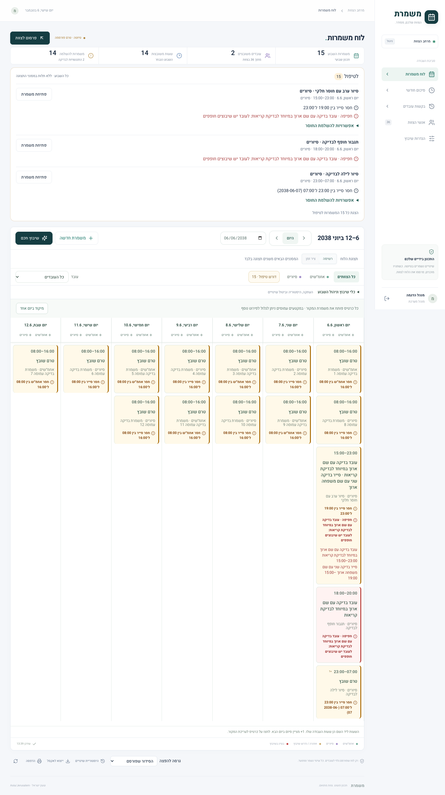
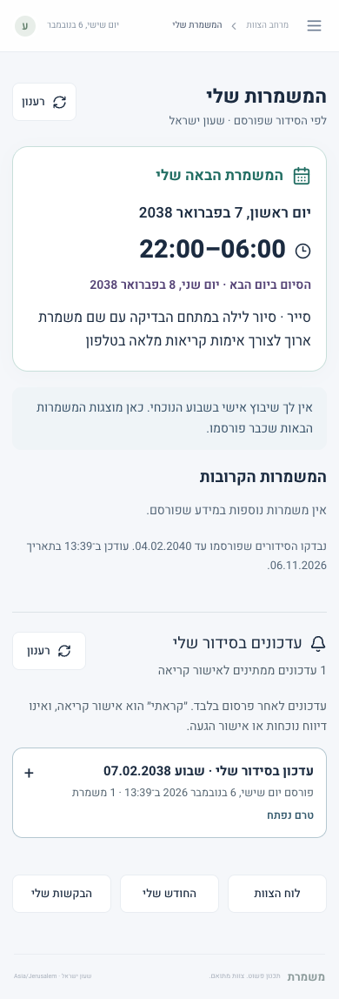

# משמרת | Mishmeret

מערכת סידור עבודה בעברית וב־RTL לאחמ״שים ולסיורים. המנהל מקבל בעיות עם אפשרויות טיפול; העובד רואה מיד את המשמרת הנוכחית או הבאה מתוך הסידור שפורסם.

הקוד בענף העבודה כולל את השיפורים המתוארים כאן. **לא בוצעה פריסת Production או מיגרציית Production בסבב זה.** [האתר החי](https://mishmeret-shifts.vercel.app) עשוי להציג גרסה קודמת. [דוח בדיקות](VERIFICATION.md) · [תהליכים והחלטות](docs/WORKFLOWS.md) · [צילומים והיקף האימות](docs/screenshots.md).

## חוויית המנהל

1. **לטיפול:** רשימה קומפקטית של חוסרים, חפיפות ואילוצים, עם יום ושעות, משמרת מקור וקיצור לעריכה. לחוסר מוצעים עובדים המתאימים לטווח לפי תפקיד, זמינות, מנוחה ומכסה. ההצעה היא לפי הכללים והמידע הקיים, ללא הבטחה לאופטימום.
2. **כיסוי לפי זמן:** לדוגמה, דרישה לשני סיירים כאשר אחד מסיים ב־19:00 מציגה ״חסר סייר בין 19:00 ל־23:00״. אותו אדם לא נספר פעמיים. האזהרות כתובות גם בכרטיסים בנייד; שבוע ריק מסומן ככיסוי שטרם הוגדר.
3. **תחום פעולה מפורש:** בוחרים ימים וצוותים בחלון השיבוץ. מסנני התצוגה אינם קובעים את תחום הפעולה. בדיקות האילוצים מתחשבות גם במשמרות אחרות ובשבועות שכנים.
4. **הצעה לפני שמירה:** ״השלמת חוסרים״ היא ברירת המחדל ומשמרת שיבוצים קיימים. ״תיקון שיבוצים״ מאפשר הצעות לשינוי. שתי הפעולות מכבדות נעילות. הסתירה בין נעילה לכלל נשארת לטיפול ואינה עוקפת חסימה.
5. **החלה מדויקת:** ההצעה נשמרת בנפרד עד 30 דקות. רק ״החלה על הטיוטה״ שומרת אותה, בלי להריץ מחדש את המנוע. שינוי בגרסה, בזמינות, בכללים או בהתחייבויות הרלוונטיות פוסל הצעה ישנה. השמירה אטומית, מתועדת וניתנת לביטול בהיסטוריית השבוע.
6. **בדיקה לפני פרסום:** מוצגים הבדלים מהפרסום האחרון, עובדים מושפעים, חוסרים ושגיאות. שגיאות חוסמות גם בקשת API ישירה. פרסום עם חוסר דורש אישור מפורש, המתועד בהיסטוריה. אישור זה אינו עוקף אילוצים.



רשימה וציר זמן הן שתי תצוגות של אותן רשומות. הכרטיס פותח רשומות מקור בלבד. בציר הזמן קנה המידה מותאם לקריאות והשעות המדויקות כתובות בכרטיסים; ניתן לגלול במקטעים עמוסים. ״היום״ מאפס גם את השבוע וגם את היום הפעיל. רק העדפת התצוגה נשמרת בדפדפן.

## חוויית העובד

מסך הכניסה מציג ״משמרת נוכחית״ כאשר העובד עובד עכשיו; אחרת ״המשמרת הבאה שלי״. החיפוש מתבצע בכל הפרסומים העתידיים הזמינים, ולא רק בשבוע הנבחר. שעות העבודה האישיות, התפקיד ויום הסיום מופיעים במפורש, כולל משמרות לילה.

בהמשך מוצגות משמרות קרובות בסדר כרונולוגי, עדכונים אישיים וקיצורים לבקשות, ללוח הצוות ולחודש שלי. יש הבחנה בין שבוע שטרם פורסם, היעדר שיבוץ אישי, סוף המידע העתידי ושגיאת טעינה. טיוטות, הערות ניהוליות, פרטי קשר ואילוצים אישיים של אחרים אינם נשלחים לעובד.



## בקשות עובדים ועדכונים

- העובד יכול להגיש בקשת היעדרות או אי־זמינות לפי תאריכים ושעות, ולראות רק את בקשותיו. הסטטוסים הם ממתין, אושר, נדחה ובוטל. הגשה חוזרת לאחר כשל תקשורת אינה יוצרת כפילות לאותה בקשה.
- המנהל רואה את הבקשות והשיבוצים המושפעים בטיוטה ובפרסום. אישור מוסיף אילוץ שמקורו בבקשה ומציף בעיות בסידור; הוא אינו מוחק שיבוץ ואינו משנה פרסום. החלטות נשמרות עם בקרת גרסה והיסטוריה.
- עובד יכול לבטל בקשה ממתינה. ביטול אישור קיים נעשה בידי מנהל ומסיר רק את האילוץ של אותה בקשה. שינויים בסידור שפורסם עדיין מחייבים פרסום נוסף.
- לאחר פרסום נוצר עדכון בתוך המערכת רק לעובד ששיבוצו נוסף, בוטל או השתנה. ההשוואה היא בין פרסומים בלבד. שינוי בהערה ניהולית או בעובד אחר אינו יוצר עדכון אישי.
- ״נפתח״ ו״קראתי״ נשמרים בנפרד. אישור קריאה אינו אישור נוכחות. אין SMS, WhatsApp או Push אוטומטיים, ואין סימון ״נשלח״ ללא שליחה. אין יצירה בדיעבד של עדכונים לפרסומים שקדמו למיגרציה.

## תבניות והפצה

אפשר ליצור תבנית יומית או שבועית מטופס או מלוח קיים, לשנות שם, לערוך, לשכפל ולסמן מועדפות אישיות למנהל. שינוי תבנית אינו משנה שבועות שכבר הוכנו ממנה. אחרי שמירה אפשר לעבור ישירות להכנת השבוע ולבדוק ימים וצוותים לפני החלה. שיבוצים אישיים והערות אינם נשמרים בתבנית.

בייצוא Excel ובהדפסה בוחרים במפורש **סידור שפורסם** או **טיוטה**. ברירת המחדל להפצה היא הפרסום; טיוטה מסומנת בבירור בקובץ ובכל גיליון. עובד תמיד רואה פרסום, גם אם מבקש טיוטה ב־URL.

הסיכום החודשי נשאר דוח **שיבוץ מתוכנן** לפי פרסומים: לא נוכחות, לא שכר ולא דיווח ביצוע. הוא מחשב זמן ב־Asia/Jerusalem, לרבות חציית חודש ושינוי שעון.

## טכנולוגיות ואבטחה

Next.js 16 / React / TypeScript, PostgreSQL עם Prisma, Zod, sessions בשרת, Tailwind/Radix, Temporal ו־ExcelJS. גרסאות נעולות ב־package-lock.json. מנוע השיבוץ הקיים הוא greedy ודטרמיניסטי, ללא שירות AI חיצוני.

כל הרשאה נאכפת בשרת. תפקיד העבודה ״אחמ״ש״ נפרד מהרשאת המערכת `ADMIN`. בקשות שינוי מחייבות Origin תקין; סיסמאות נשמרות כ־bcrypt, ו־sessions נשמרים כגיבוב עם cookie HttpOnly. טיוטה ופרסום נשמרים בנפרד; פעולות שבוע, הצעות ובקשות משתמשות בטרנזקציות ובבקרת גרסה. לא נשמרים שיבוצים או טופסי בקשות ב־localStorage.

## הפעלה מקומית

נדרשים Node.js 22 ו־PostgreSQL. אין fallback למסד בזיכרון.

```bash
npm ci
cp .env.example .env
```

הגדירו `DATABASE_URL` למסד שלכם ו־`APP_URL=http://localhost:3000`. אפשר להפעיל PostgreSQL באמצעות `docker compose up -d db` לאחר הגדרת `POSTGRES_PASSWORD` וכתובת החיבור.

```bash
npm run db:generate
npm run db:migrate
npm run dev
```

למסד בדיקות ריק בלבד ניתן להגדיר `SEED_DEMO=true`, `DEMO_ADMIN_PASSWORD` ו־`DEMO_EMPLOYEE_PASSWORD`, ואז להריץ `npm run db:seed`. ה־seed אינו דורס מסד קיים. חשבונות ההדגמה הם `admin@demo.local` ו־`employee@demo.local`; הזינו את הסיסמאות שבחרתם. כפתורי הדמו בדף הכניסה ממלאים פרטי הדגמה מובנים. אם בחרתם סיסמאות אחרות, הזינו אותן ידנית; ערכי `.env.example` הם placeholders להחלפה.

לסביבה פרטית הגדירו `SEED_DEMO=false`, והגדירו באופן פרטי `ADMIN_EMAIL`, `ADMIN_NAME`, `ADMIN_PASSWORD` לפני `npm run admin:create`. הסקריפט דורש 12 תווים לפחות ואינו משנה מנהל קיים. ניהול הצוות מאפשר יצירת חשבונות עובדים.

### מיגרציות הסבב

- `20261106000000_schedule_proposals` מוסיפה הצעות שיבוץ נשמרות.
- `20261106010000_employee_workflows` מוסיפה בקשות והיסטוריית החלטות, עדכונים אישיים, גרסת תבנית ומועדפות מנהל.

המיגרציות מוסיפות שדות וטבלאות ואינן מוחקות סידורים או פרסומים. על מסד הבדיקות המאוכלס נבדק שספירת הרשומות ותוכן הטיוטות והפרסומים לא השתנו לאחר מיגרציית שלב ב׳. נעילות ושיוך אילוץ לבקשה הם שדות אופציונליים ב־JSON הקיים. לפני הפצה נדרשים גיבוי ומיגרציה מבוקרת למסד היעד; Production לא עודכן כאן.

## בדיקות

```bash
npm test
npm run lint
npm run typecheck
npm run build
```

בדיקות E2E כותבות נתונים פיקטיביים. **יש להריץ אותן רק על מסד בדיקות נפרד.** להרצה סדרתית עם ניקוי מוני התחברות במסד הבדיקות בלבד:

```bash
TEST_DATABASE_URL='postgresql://USER@127.0.0.1:PORT/NAME_test' \
BASE_URL=http://localhost:3336 npm run test:e2e:local
```

הגדירו גם `DEMO_ADMIN_PASSWORD` ו־`DEMO_EMPLOYEE_PASSWORD` אם סיסמאות מסד הבדיקות שונות מערכי הדמו המובנים. הכלי דורש כתובות localhost ושם מסד שמסתיים ב־`_test`. הוא שומר דוחות ב־`output/playwright/reports` וצילומים ב־`output/playwright`; אלה מוחרגים מ־Git. אפשר להעביר קובצי בדיקה מסוימים אחרי `--`.

אפשר להפעיל build לבדיקות לצד שרת פיתוח קיים:

```bash
NEXT_DIST_DIR=.next/review-build npm run build
NEXT_DIST_DIR=.next/review-build PORT=3336 APP_URL=http://localhost:3336 npm start
```

בכל פקודה הגדירו גם `DATABASE_URL` של מסד הבדיקות. משתני סביבה מפורשים קודמים לערכים ב־`.env`. `next dev` ו־build עשויים לעדכן קבצי TypeScript שנוצרים אוטומטית בהתאם לתיקיית הבנייה.

## פריסה וגבולות האימות

הפרויקט תומך ב־Vercel/PostgreSQL מנוהל או בשרת Node/Docker. אין מיגרציות אוטומטיות בזמן build. הגדירו מסד נפרד לכל סביבה, `APP_URL` מדויק ו־HTTPS; הריצו מיגרציות מבוקרות לפני הפעלת הגרסה. אין צורך בשירות בתשלום נוסף לצורך היכולות שבסבב זה.

תוצאות הריצות בפועל ומגבלותיהן מופיעות ב־[VERIFICATION.md](VERIFICATION.md). בדיקת רוחב דפדפן אינה בדיקת טלפון פיזי. לא נוספו שכר, נוכחות, סליקה, ארגונים נוספים או מחלקות נוספות. אין עבודה עם לוחות פרטיים offline, איפוס סיסמה בדוא״ל או מערכת החלפות בין עובדים. Build תקין אינו הכרזה על מוכנות לייצור.
